# Piyasa — Android piyasa widget'ı

Ana ekranda **şık ve kompakt** bir widget ile:

- **Amerika piyasaları**: S&P 500, Nasdaq, Dow Jones, Russell, VIX, ABD 10Y faizi, büyük teknoloji hisseleri
- **Türkiye piyasaları**: BIST 100 / 30 / Banka ve BIST hisseleri
- **Emtia (spot)**: ons altın, gümüş, platin, paladyum, bakır; Brent, WTI ve doğalgaz (vadeli)
- **Döviz**: USD/TRY, EUR/TRY, GBP/TRY, CHF/TRY, EUR/USD, DXY, TCMB gösterge kurları
- **Formüller**: göstergeleri birleştiren hesaplar, örneğin `GRAM_ALTIN = ONS * USDTRY / OZ`

Uygulamanın kendi ekranı yalnızca ayar içindir. Veriler widget'ta gösterilir.

> **Web sürümü:** aynı uygulama tarayıcıda, kurulum gerektirmeden. Canlı fiyatlar, formüller, panolar (widget'ların karşılığı) ve dinamik listeler.
> **https://nniyazii.github.io/piyasa-widget/**: ayrıntılar [web/README.md](web/README.md).
>
> 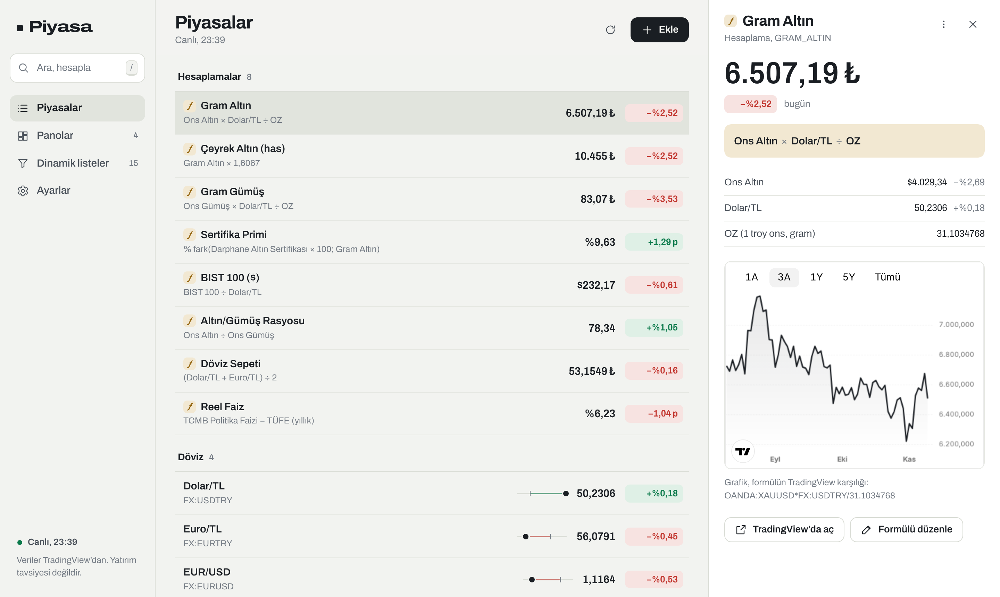

| Liste (4×2, 2×2) | Bant (4×1) |
|---|---|
| 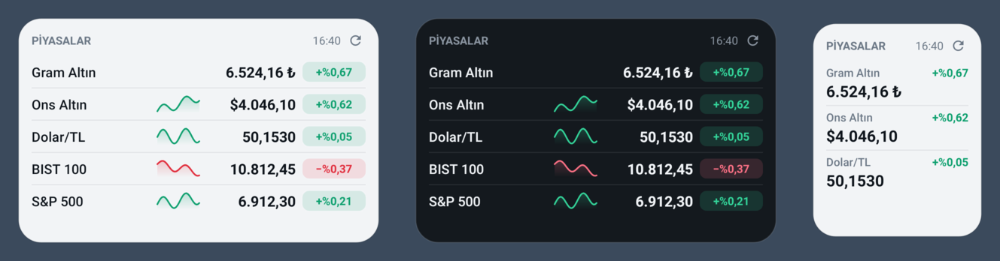 | 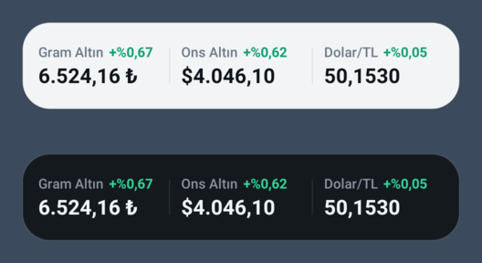 |

| Geniş, çift sütun (5×3) | Alt satırda formül |
|---|---|
| 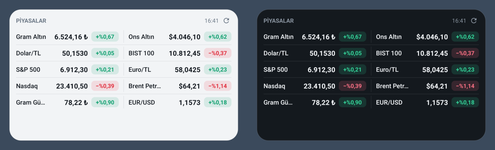 | 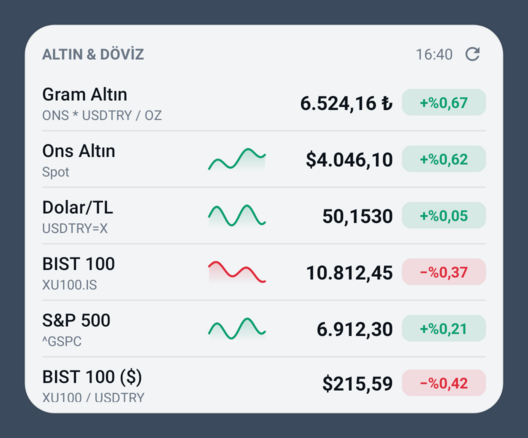 |

> Görseller `./gradlew testDebugUnitTest -Ppreviews=true` komutuyla gerçek widget kodundan (Robolectric) üretilir. Örnek veriler kullanılmıştır.

## Widget

- **Boyuta göre düzen**: 1 satır yükseklikte yatay bant, 2 hücre genişlikte iki satırlı dar liste, standart genişlikte mini grafikli liste, 5+ hücre genişlikte çift sütun.
- **Listeyi tek dokunuşla widget yap.** Bir dinamik listeye basılı tutup bırakın → *Ana ekrana widget olarak ekle* (ya da liste ekranında ⌂ simgesi). Listedeki bir grup (Hesaplamalar, Döviz, Emtia …) için başlığındaki ⋮ menüsü. Başlatıcı onay penceresinde widget'ın gerçek içeriği önizlenir; eklendiğinde widget hazır gelir: başlık liste adı, ilk 10 sonuç, her yenilemede güncellenir. *Ayarlar → Ana ekrana widget ekle* boş/varsayılan widget ekler.

  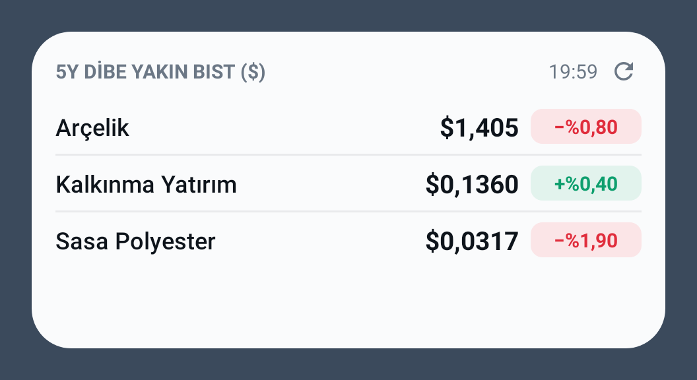
- **Her widget ayrı yapılandırılır.** Widget'ı eklerken açılan ekrandan veya widget'a uzun basıp *Yeniden yapılandır* ile ayarlanır. Ekranın üstünde, widget'ın gerçek boyutunda **canlı önizleme** vardır; her değişiklik anında görünür.
  - **İçerik:** göstergeler, formüller ve **bölümler** (ör. Altın · Döviz · Borsa). *+ Bölüm* hazır başlık önerileri sunar. *Otomatik bölümle* göstergeleri kategoriye göre gruplar. **Sürükle-bırak** ile sıralanır (≡ tutamacından hemen, satıra basılı tutarak da); bölüm başlıkları çift sütunda da satırı keser.
  - **Görünüm:** yazı boyutu (Küçük / Normal / Büyük / Çok büyük), satır aralığı (Sıkı / Normal / Rahat), günlük değişim (Rozet / Yazı / Gizli), tema (Sistem / Açık / Koyu), arka plan opaklığı (%20–100), başlık satırı, güncelleme saati, mini grafik ve alt satır. Büyük yazıda yer kalmazsa mini grafik otomatik gizlenir.

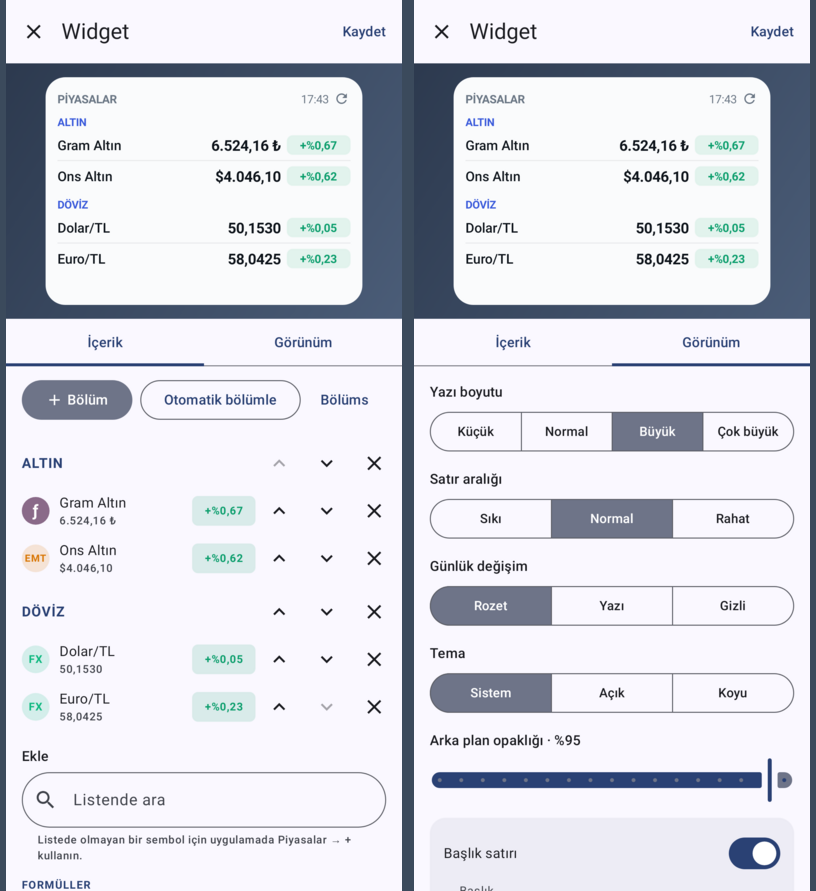

| Bölümler | Büyük yazı · Sıkı ve küçük · Koyu, yarı saydam |
|---|---|
| 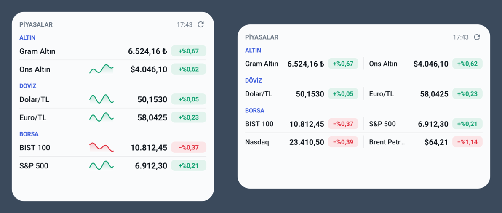 | 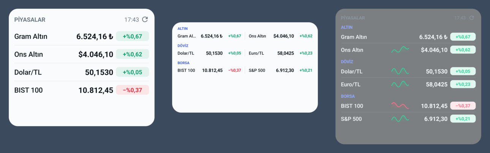 |
- **Satıra dokununca TradingView açılır.** Telefonda TradingView uygulaması yüklüyse grafik orada açılır. Formüller TradingView'un spread sözdizimine çevrilir:
  `GRAM_ALTIN` → `OANDA:XAUUSD*FX:USDTRY/31.1034768`, `BIST_USD` → `BIST:XU100/FX:USDTRY`.
  TradingView'da karşılığı olmayan fonksiyonlar (`pct`, `chg`, `prev`, `min`…) içeren formüllerde, formüldeki ilk enstrüman açılır.
- ⟳ simgesi verileri hemen yeniler. Arka planda 15, 30, 60 veya 120 dakikada bir otomatik yenilenir.
- Gece ve gündüz temaları sistemi izler.

## Ekle: sembol ve formül tek ekranda

Uygulamada tek bir liste ve tek bir yuvarlak **+** düğmesi vardır. **+** ile açılan ekranın üstünde hesap makinesi gibi bir ekran, altında tanıdık bir **hesap makinesi tuş takımı** bulunur. Ne yaptığınızı seçmezsiniz; uygulama yazdığınızdan anlar:

| Yaptığınız | Sonuç |
|---|---|
| `aselsan` yazıp sonuca dokunmak | Sembol listeye eklenir (✓ · Geri al) |
| `ons` **×** `dolar` **÷** `oz` **=** | Formül kaydedilir: ad “Gram Altın”, birim ₺ önerilir |
| `xu100 / usdtry` yazıp Enter | Formül kaydedilir: “BIST 100 ($)” |
| `OANDA:XAUUSD*FX:USDTRY/31.1` | TradingView yazımı da olduğu gibi çalışır |

- **Operatöre basmak, yazılan kelimeyi en iyi eşleşen sembole dönüştürür** (TradingView'daki gibi): önce listendekiler (formüllerin dahil), sonra katalog ve tüm piyasalar. Listende olmayan bir sembol formülde kullanılırsa kaydederken listeye de eklenir.
- Yazarken **canlı ara sonuç** soluk renkte görünür; ifade tamamlanınca koyulaşır. Günlük değişim ve TradingView karşılığı da gösterilir.
- Tuş takımı (Google Hesap Makinesi gibi 4×5): `C ( ) ƒ ÷ / 7 8 9 × / 4 5 6 − / 1 2 3 + / abc 0 , =`. Tek `( )` tuşu bağlama göre açar veya kapatır; ⌫ ekranın yanındadır (basılı tutunca temizler). `ƒ` menüsünde % fark, günlük %, önceki kapanış, ortalama, min/max, yuvarla ve OZ bulunur. `abc` harf klavyesini açar; klavye açıkken tuş takımı gizlenir.
- `=`, ad (otomatik önerilir), birim (yok / ₺ / $ / € / %) ve ondalık seçimi sunar. Formülü düzenlemek için listede basılı tutup bırakın ve *Düzenle*'yi seçin; aynı ekran açılır.

**Uygulama listesinde sıralama:** satıra basılı tutun, satır kalkınca sürükleyin. Göstergeler kendi grubu (Döviz, Emtia …) içinde, formüller Hesaplamalar içinde, dinamik listeler kendi aralarında yer değiştirir. Basılı tutup sürüklemeden bırakmak menüyü açar; kısa dokunuş TradingView'u açar.
- Boş ekranda örnek formüller ve önerilen semboller görünür. TCMB kuru veya Yahoo sembolü için *Gelişmiş* bölümü en altta durur.

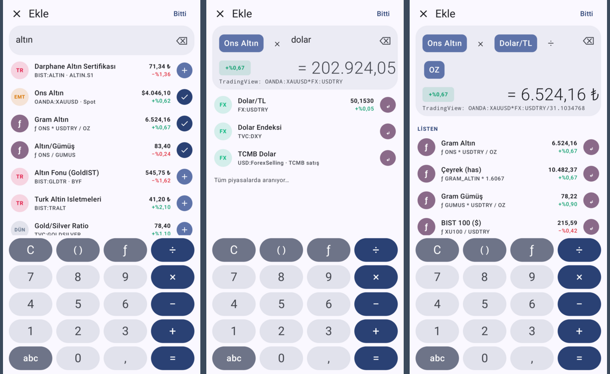

### Sembol arama

Kaynak seçmek, sembol biçimi öğrenmek ya da form doldurmak gerekmez; ne biliyorsanız onu yazarsınız:

| Yazdığınız | Bulunan |
|---|---|
| `ALTIN.S1` | BIST:ALTIN, Darphane Altın Sertifikası |
| `gmstr.f` | BIST:GMSTR, Gümüş Fonu |
| `trhpi` veya `konut` | ECONOMICS:TRHPI, Konut Fiyat Endeksi |
| `altın` | Darphane sertifikası, Altın Fonu, Ons Altın… |
| `aselsan`, `BIST:THYAO`, `apple`, `bitcoin` | … |

- Sonuçlar canlı fiyat ve günlük değişimle gelir; doğru şeyi bulduğunuzu eklemeden önce görürsünüz.
- **Satıra dokunmak = eklendi.** Altta “✓ eklendi · Geri al” bildirimi çıkar ve ekran açık kalır.
- Türkçe kelimeler İngilizce karşılıklarıyla da aranır (altın → gold, konut → house price, enflasyon → inflation).
- Arama sırası: önce kesin kod eşleşmesi, sonra Türkiye, emtia, döviz, ABD (birincil listeler, piyasa değerine göre), ekonomik göstergeler ve kripto (spot, büyük borsalar).
- Kategori, ondalık, birim (₺ / $ / €) ve formül anahtarı otomatik belirlenir.

## Formül dili

| | |
|---|---|
| Operatörler | `+ - * / ^ ( )`. Ondalık ayırıcı nokta (`31.1`), argüman ayırıcı `,` veya `;` |
| Değişkenler | Enstrüman ve formül anahtarları (`USDTRY`, `ONS`, `GRAM_ALTIN`…). Büyük/küçük harf fark etmez |
| Sabitler | `OZ` = 31,1034768 (troy ons → gram), `PI`, `E` |
| Fonksiyonlar | `min max avg sum abs sqrt pow ln log exp round(x; n) floor ceil` |
| Kıyas | `pct(a; b)`: a'nın b'ye göre % farkı · `prev(x)`: önceki kapanış · `chg(x)`: günlük % değişim |

Formüller başka formülleri kullanabilir (`CEYREK = GRAM_ALTIN * 1.6067`). Döngüsel referanslar yakalanır. Bir formülün günlük değişimi, aynı formül önceki kapanış fiyatlarıyla hesaplanarak bulunur.

## Dinamik listeler (filtreler)

Kendiliğinden güncellenen listeler: koşulları bir kez kurarsın, her yenilemede yeniden taranır. **+ → Dinamik liste oluştur** ile açılır; listede basılı tutup bırakınca açılan menüde *Düzenle* ile değiştirilir, basılı tutup sürükleyerek sıralanır. Widget düzenleyicisinde *Ekle → Dinamik listeler* ile widget'a da konur; widget'ta başlık ve ilk 3–10 sonuç görünür.

Uygulamaya **15 hazır dinamik liste** gelir (eski kurulumlarda da eklenir; silersen geri gelmez, *Varsayılan listeye dön* geri getirir). Hepsi yeni liste için şablon olarak da kullanılabilir.

| Hazır liste | Kurulum | 10 Kas 2026'da |
|---|---|---|
| **5 yıllık dibe yakın BIST ($)** | BIST hisseleri · USD · `Fiyat ≤ 5 yıl en düşük +%10` | Arçelik, Kalkınma Yatırım, Sasa |
| **200 günlük ortalama civarı (listemdeki ABD)** | Listem · Amerika · `Fiyat < 200 günlük ortalama +%5` | Nasdaq, S&P 500, Dow (listene ABD hissesi ekledikçe onlar da) |
| Günün yıldızları (BIST) | `Günlük değişim % ≥ 4` · `Piyasa değeri > 5 mlr` · en çok yükselen, 10 | 10 hisse |
| Aşırı satılmış BIST devleri | `RSI (14) < 35` · `Piyasa değeri > 50 mlr` | Türkiye Sigorta, Tüpraş |
| Trendde ve ucuz (BIST) | `0 < F/K < 10` · `Fiyat > 200 günlük ort.` · `50 günlük ort. > 200 günlük ort.` · `Piyasa değeri > 10 mlr` | Tüpraş, Halkbank, Alarko … (6) |
| Zirveye yakın BIST hisseleri | `Fiyat ≥ 52 hafta en yüksek −%5` · `Piyasa değeri > 20 mlr` | 3 hisse |
| Düşüşteki ABD devleri | ABD · `Fiyat ≤ 52 hafta en düşük +%15` · `Piyasa değeri > 100 mlr $` | Netflix, Nvidia, Boeing, Alphabet … (19) |
| **F/K'sı 5 yıllık ortalamasının yarısına inenler (listem)** | Listem · yalnızca hisseler · `F/K ≤ 5 yıllık ortalama F/K −%50` · `F/K > 0` · en uç önce | listene eklediğin hisselerden (ör. PayPal, Nvidia, Tüpraş) |
| Tarihine göre ucuzlamış BIST devleri | `F/K ≤ 5 yıllık ort. F/K −%40` · `F/K > 0` · `Piyasa değeri > 50 mlr` | Coca-Cola İçecek, Aygaz, Tüpraş, Sabancı … (9) |
| Tarihine göre ucuzlamış ABD devleri | ABD · `F/K ≤ 5 yıllık ort. F/K −%25` · `F/K > 0` · `Piyasa değeri > 100 mlr $` | Nvidia, Netflix, Amazon, Oracle … (8) |
| Kârı artması beklenen ucuz BIST | `Beklenen F/K ≤ F/K −%30` · `0 < F/K < 15` · `Beklenen F/K > 0` · `Piyasa değeri > 20 mlr` | Doğuş Otomotiv, Ülker, Torunlar, Türk Telekom … (8) |
| Defter değerinin altında, kârlı BIST | `0 < PD/DD < 1` · `Özsermaye kârlılığı > %10` · `Piyasa değeri > 10 mlr` | Halk GYO, Rönesans GYO, THY … (18) |
| Yüksek temettü verimli BIST | `Temettü verimi ≥ %6` · `Piyasa değeri > 20 mlr` | Doğuş Otomotiv, Nuh Çimento, Ford Otosan … (12) |
| Kaliteli ve makul fiyatlı ABD devleri | ABD · `ÖK kârlılığı > %20` · `Net marj > %15` · `Borç/Özsermaye < 1` · `0 < F/K < 25` · `Piyasa değeri > 100 mlr $` | Nvidia, Alphabet, Amazon, Meta … (13) |
| Büyüyen ama geri çekilen ABD devleri | ABD · `Fiyat < 200 günlük ort.` · `EPS büyümesi (5 yıl, yıllık) > %15` · `Piyasa değeri > 50 mlr $` | American Express, Blackstone, Tesla … (20) |

İlk ikisi ve *F/K'sı 5 yıllık ortalamasının yarısına inenler* kullanıcının istediği örnekler; eski kurulumlara 0.7.0 ile yalnızca yeni temel analiz listeleri eklenir. Diğerlerinde piyasa değeri eşiği küçük ve sığ hisseleri eler (BIST ₺, ABD $; düzenleyicide milyar cinsinden girilir). Listedeki *yalnızca hisseler* açılırsa endeksler hariç tutulur.

- **Nerede:** Listem (istersen tek kategori, istersen yalnızca hisseler), tüm BIST hisseleri, ABD hisseleri (piyasa değeri 2 milyar $ üstü).
- **Koşul:** `[alan] [< ≤ > ≥] [sayı]` ya da `[alan] [< ≤ > ≥] [başka alan ± %]`. Birden çok koşul *tümü* ya da *herhangi biri* olarak birleşir.
- **Alanlar:** fiyat, günlük değişim, 20/50/100/200 günlük ortalama, 200 günlük üssel ortalama, 52 hafta en düşük/yüksek, **5 yıl en düşük/yüksek**, tüm zamanların en düşük/yükseği, RSI (14), 1 ay / 3 ay / yılbaşından beri / 1 yıl / 5 yıl getiri, piyasa değeri, F/K.
  - **Değerleme:** **5 yıllık ortalama F/K**, beklenen F/K (gelecek yıl kâr tahminiyle), PEG, PD/DD, Fiyat/Satış, FD/FAVÖK, temettü verimi.
  - **Kârlılık ve büyüme:** özsermaye kârlılığı, net kâr marjı, borç/özsermaye, EPS büyümesi (1 yıl ve 5 yıllık yıllık ortalama), gelir büyümesi (1 yıl).
- **5 yıllık ortalama F/K:** son 5 mali yılın her biri için *yıl sonu kapanış fiyatı ÷ o yılın EPS'i* (Eylül'de biten mali yılda Eylül kapanışı). Zararlı yıllar ve kârın sıfıra yakın olduğu için F/K'sı 100'ü aşan yıllar ortalamayı bozmasın diye atlanır; en az 3 geçerli yıl gerekir. Not: BIST'te yüksek enflasyon nominal kârı büyüttüğü için bugünkü F/K tarihsel ortalamanın altında kalmaya yatkındır; eşik bu yüzden BIST'te daha sıkıdır.
- **USD cinsinden:** TL fiyatlar Dolar/TL'ye bölünür. 5 yıllık dip ve zirve, her ay o ayın kuruyla USD'ye çevrilmiş aylık geçmişten hesaplanır; böylece "dolar bazında dip" gerçekten dolar bazındadır. Ortalamalar ve 52 hafta değerleri bugünkü kurla çevrilir (oranları değişmez).
- **Sıralama:** koşula en yakın (dibe, ortalamaya ya da zirveye en yakın önce; RSI gibi sayılarda en uç önce), **en uç değer** (ör. F/K'sı ortalamasının en çok altında olan önce), en çok yükselen/düşen, piyasa değeri, ad. En fazla 10–50 sonuç.
- Düzenlerken **canlı önizleme** gösterilir. Sonuç ekranında her satırda koşula uzaklık yazar ("5 yıl en düşük: %4,2 üstünde"); dokununca TradingView açılır, + ile listene eklenir.

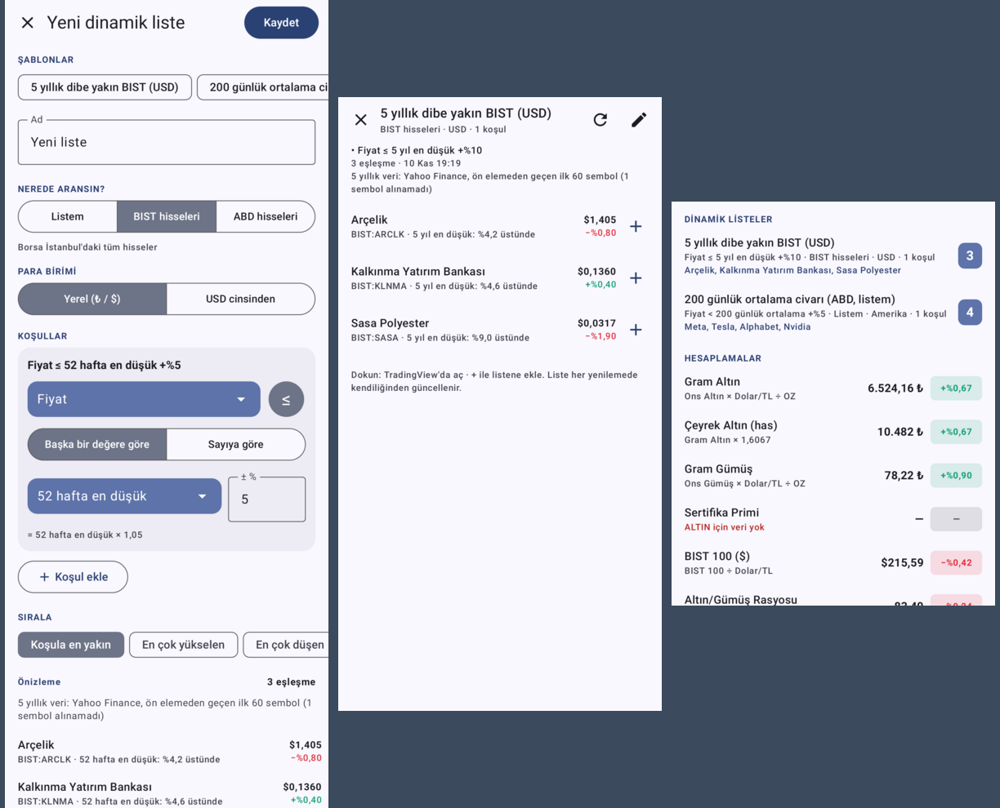

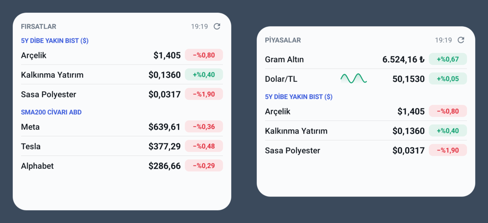

**Nasıl çalışır:** Tarama TradingView'un tarayıcı servisiyle yapılır: evren ve sayısal koşullar mümkün olduğunda sunucuda ön elenir, kalanlar uygulamada değerlendirilir. TradingView 5 yıllık dip/zirve ve geçmiş F/K vermediği için bu alanlar Yahoo Finance aylık geçmişinden, yalnızca ön elemeden geçen ilk 60 aday için hesaplanır ve gün boyunca önbellekte tutulur. EPS ve gelir büyümesi, beklenen F/K TradingView'un yıllık bilanço dizilerinden uygulamada hesaplanır. Listemdeki BIST hisseleri TradingView'un Türkiye ucundan sorgulanır (genel uç piyasa değerini ve tahminleri USD'ye çeviriyor); böylece "Piyasa değeri > 50 mlr" her yerde ₺ demektir.

## Varsayılan liste

İlk kurulumda derli toplu bir liste gelir. *Ayarlar → Varsayılan listeye dön* ile istediğiniz zaman bu listeye dönebilirsiniz (widget ayarları korunur).

| Grup | Göstergeler |
|---|---|
| Döviz | Dolar/TL, Euro/TL, EUR/USD, Dolar Endeksi |
| Emtia | Ons Altın, Ons Gümüş (spot), Brent Petrol |
| Türkiye | BIST 100, BIST 30, Darphane Altın Sertifikası (ALTIN.S1) |
| Amerika | S&P 500, Nasdaq, Dow Jones, ABD 10 Yıllık Tahvil |
| Kripto | Bitcoin |
| Ekonomi | TÜFE (yıllık), TCMB Politika Faizi |

| Hesaplama | Formül | Not |
|---|---|---|
| Gram Altın | `ONS × USDTRY ÷ OZ` | 1 troy ons = 31,1034768 gr |
| Çeyrek Altın (has) | `Gram Altın × 1,6067` | 1,75 gr × 22 ayar (0,916); işçilik hariç |
| Gram Gümüş | `GUMUS × USDTRY ÷ OZ` | |
| Sertifika Primi | `% fark(ALTIN × 100; Gram Altın)` | 1 sertifika = 0,01 gr altın |
| BIST 100 ($) | `XU100 ÷ USDTRY` | Dolar bazlı endeks |
| Altın/Gümüş Rasyosu | `ONS ÷ GUMUS` | |
| Döviz Sepeti | `(USDTRY + EURTRY) ÷ 2` | 0,5 $ + 0,5 € |
| Reel Faiz | `TR_FAIZ − TR_ENF` | Politika faizi − yıllık TÜFE |

**Değişim gösterimi:** fiyatlarda günlük yüzde değişim (`+%0,18`); birimi yüzde olan oranlarda (faiz, enflasyon, prim, tahvil getirisi) **puan farkı** (`+0,04 p` = %29,73 → %29,77). Yüzde işareti Türkçe yazımla başa gelir (`%29,77`).

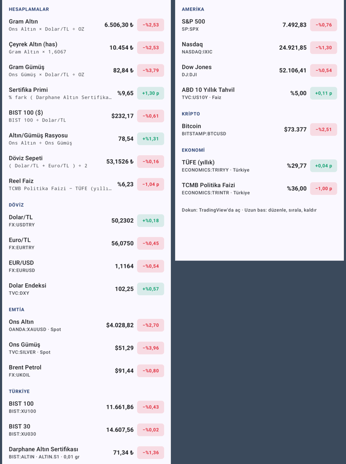

Eski sürümlerden yükseltmede katalog göstergelerinin adları ve birimleri, değiştirilmemiş eski varsayılan formüllerin adları kendiliğinden güncellenir; kendi eklediğiniz gösterge ve formüllere dokunulmaz.

## Veri kaynakları

| Kaynak | Kapsam | Not |
|---|---|---|
| TradingView tarayıcı servisi (`scanner.tradingview.com`) | Hisse, endeks, fon, sertifika, döviz, emtia, kripto, ekonomik göstergeler | Varsayılan kaynak. Tüm semboller tek istekte, anahtar gerekmez. Resmi olmayan bir uç noktadır; BIST ~15 dk gecikmeli olabilir |
| TCMB `today.xml` | Resmi gösterge kurları | Günde bir kez yayımlanır |
| Yahoo Finance, gold-api.com | Eski kurulumlar ve *Gelişmiş* girişler | 0.1 sürümünden kalan katalog göstergeleri açılışta otomatik olarak TradingView'a taşınır; anahtarlar ve formüller değişmez |

Mini grafik gün içinde yapılan her yenilemede bir nokta ekler; ilk nokta önceki kapanıştır. Böylece grafik ilk yenilemeden itibaren günün yönünü gösterir.

## Derleme

```bash
./gradlew assembleDebug          # app/build/outputs/apk/debug/app-debug.apk
./gradlew testDebugUnitTest      # birim testleri
./gradlew testDebugUnitTest -Plive=true      # gerçek TradingView servisine karşı arama/fiyat testleri
./gradlew testDebugUnitTest -Ppreviews=true  # widget ve ekran önizlemeleri (app/build/widget-previews)
```

GitHub Actions her push'ta testleri ve lint'i çalıştırır, APK'yı *Artifacts* altına koyar. `v*` etiketi (ör. `v0.1.0`) atıldığında APK bir GitHub Release'e eklenir. Release APK'sı kolay kurulum için debug anahtarıyla imzalanır. Play Store'a çıkmadan önce kendi keystore'unuzu tanımlayın.

**Teknoloji:** Kotlin, Jetpack Glance (widget), Jetpack Compose + Material 3 (ayarlar), WorkManager, DataStore, OkHttp, kotlinx.serialization. minSdk 26 (Android 8.0).

## Mimari

```
formula/   Ayrıştırıcı + değerlendirici (saf Kotlin, birim testli)
model/     Modeller, katalog, FormulaEngine, görüntü/biçim (tr-TR), TradingView çevirisi
data/      DataStore durum deposu, Actions, Repository, kaynaklar (Yahoo, gold-api, TCMB)
widget/    Glance widget'ı, alıcı, yenileme aksiyonu, mini grafik
config/    Widget başına yapılandırma ekranı
ui/        Liste, birleşik Ekle ekranı (Composer: arama + hesap makinesi), sembol arama, ayarlar
work/      Periyodik / anlık yenileme (WorkManager)
```

*Bu uygulama yatırım tavsiyesi vermez.*
