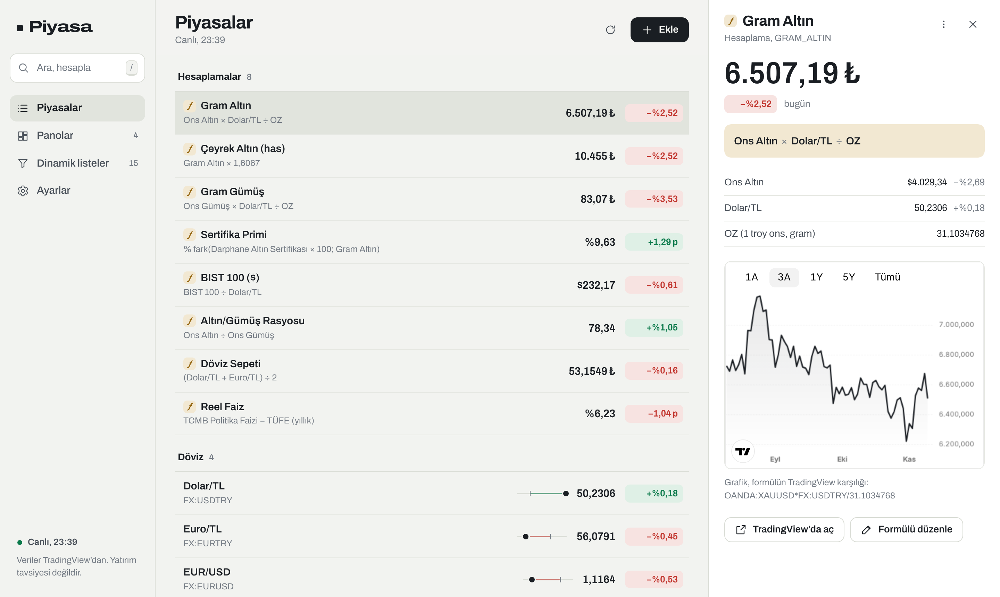
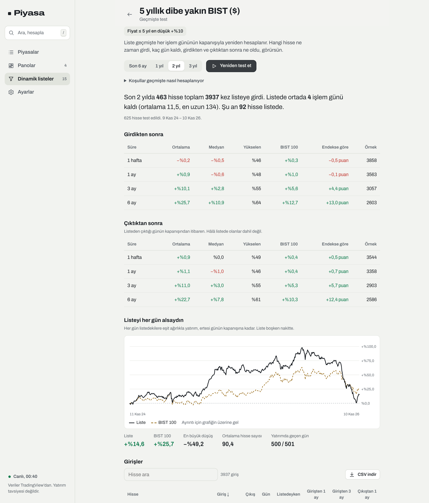
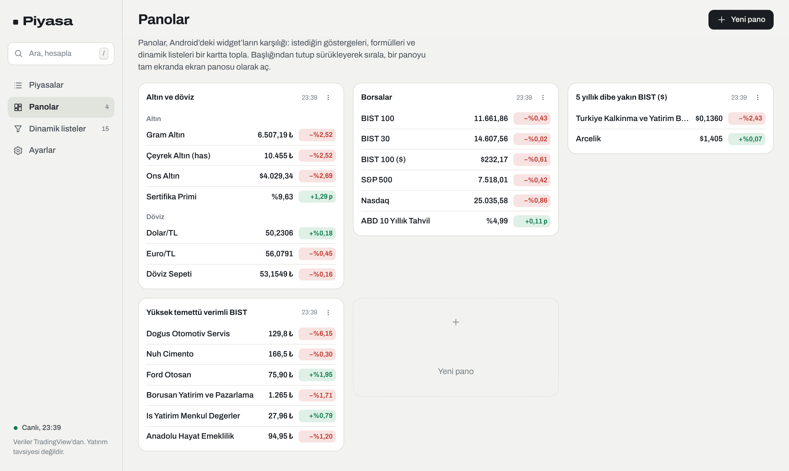
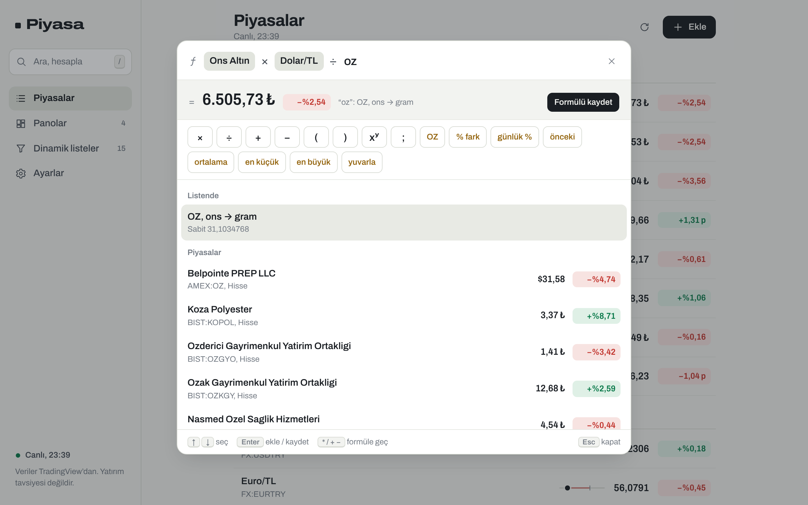
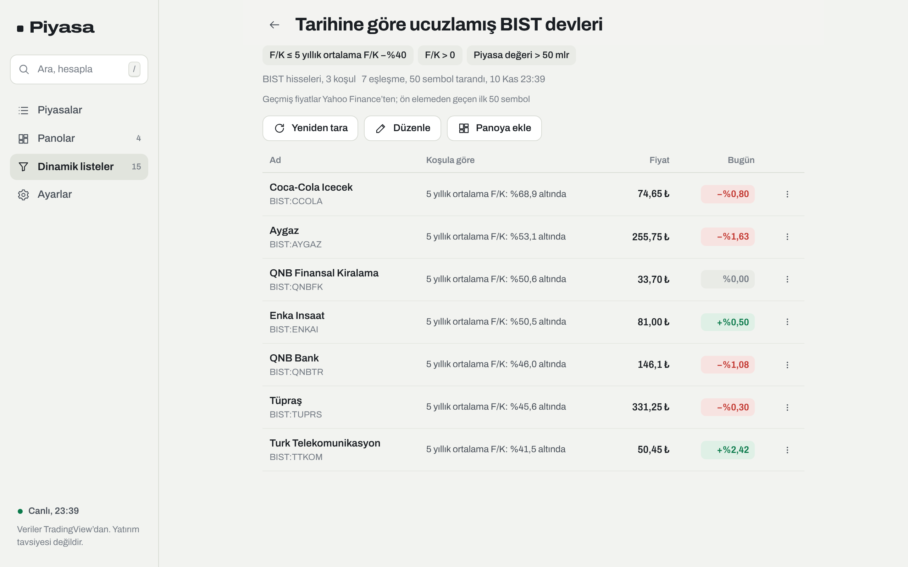
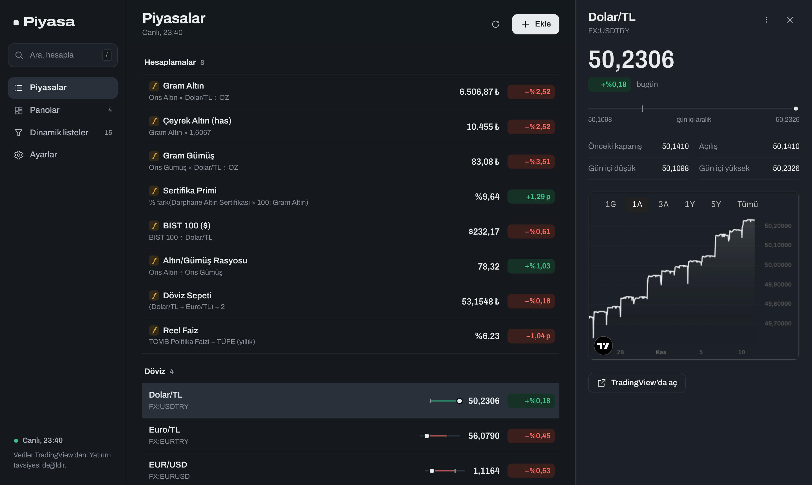
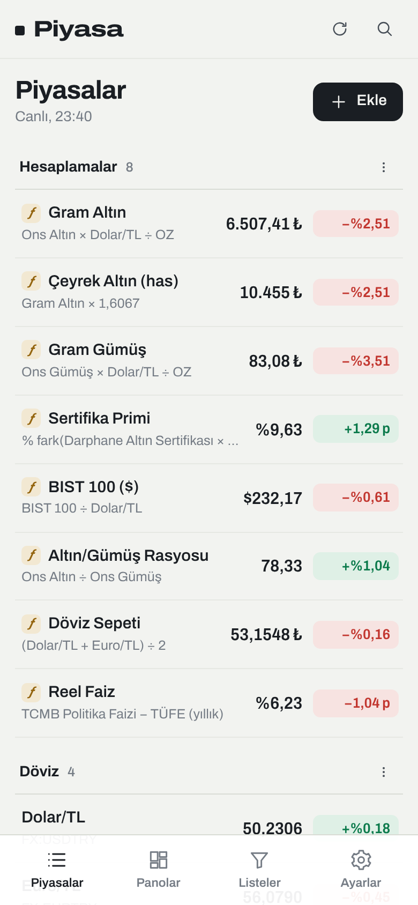
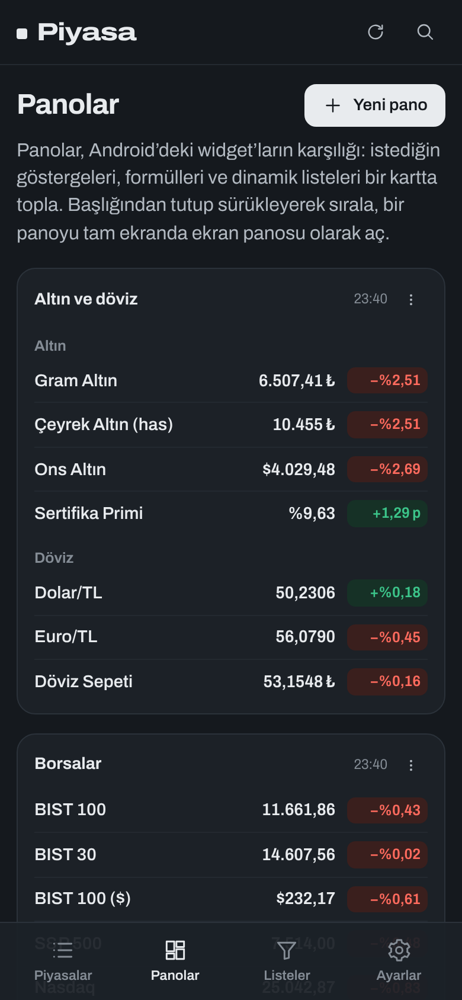
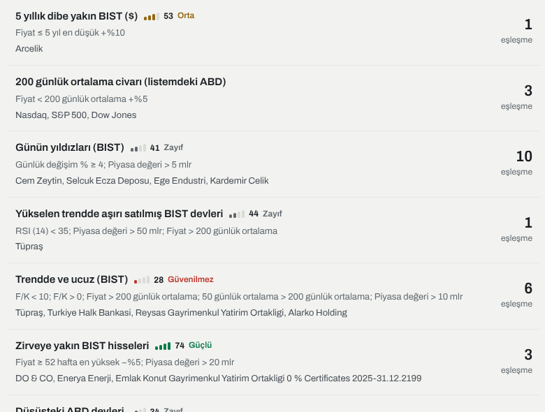
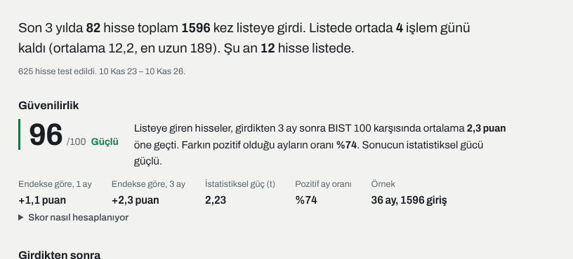

# Piyasa — web sürümü

Android widget uygulamasının tarayıcı sürümü: aynı formül dili, aynı hazır liste, aynı 15 dinamik liste.
Kurulum istemez; veriler (listen, formüllerin, panoların) yalnızca tarayıcında saklanır.

**Canlı:** https://nniyazii.github.io/piyasa-widget/



## Neler var

- **Piyasalar.** Döviz, altın, BIST, ABD, kripto ve ekonomik göstergeler; formüller ("Hesaplamalar") en üstte.
  - Sayfa açıkken fiyatlar 10 saniye ile 5 dakika arasında seçilen aralıkla yenilenir; sekme arka plandayken durur.
  - Fiyat değişince yalnızca değişen rakamlar kısa süre yeşil ya da kırmızı yanar.
  - Satırdaki ince çizgi gün içi aralıktır: düşük–yüksek, dikey işaret açılış, nokta güncel fiyat.
  - Gruplar içinde sürükle-bırakla sıralanır (telefonda basılı tut, klavyede Boşluk). Sağ tıkla diğer işlemler açılır.
- **Ayrıntı.** Büyük fiyat, gün içi aralık, önceki kapanış ve açılış; TradingView grafiği.
  - Formüllerde girdilerin tek tek değeri gösterilir. Grafik, formülün TradingView karşılığıdır (`OANDA:XAUUSD*FX:USDTRY/31.1034768`).
- **Ara ya da hesapla** (`/` ya da `Ctrl K`). Tek kutu: kelime yazarsan sembol arar, işlem yazarsan formüle geçer.
  - `ons*dolar/oz` gram altını anında hesaplar; Enter ile ad ve birim önerilerek kaydedilir.
  - `ALTIN.S1`, `gmstr.f`, `trhpi`, `BIST:THYAO` gibi kodlar da bulunur.
- **Panolar.** Android'deki widget'ların karşılığı: göstergeleri, bölüm başlıklarını ve dinamik listeleri bir kartta topla.
  - Kartlar başlığından sürüklenerek sıralanır. Satır aralığı, yazı boyutu ve değişim biçimi ayarlanır.
  - Bir pano **tam ekran** açılır (ekran panosu; ekran kararmaz).
- **Dinamik listeler.** Koşullu taramalar: "F/K’sı 5 yıllık ortalamasının yarısına inenler", "USD cinsinden 5 yıllık dibe yakın BIST" ve 16 tane daha.
  - Her listenin yanında **güvenilirlik skoru** (0–100): liste geçmişte endeksi tutarlı biçimde geçti mi? Hazır listelerin skoru her gün son 3 yılla yeniden hesaplanır; kendi listelerin, geçmişte test ettiğinde skor alır.
  - **Sıralama:** listeler kendi sırana (sürükle-bırak), güvenilirlik skoruna, eşleşme sayısına ya da ada göre dizilir. Liste sonuçlarında *Ad*, *Fiyat* ve *Bugün* başlıklarına basınca o sütuna göre sıralanır; *Koşula göre* listenin kendi sırasına döner.
  - **Hepsini tara:** ilerlemeyi düğmede gösterir ("Taranıyor 7/18"), bitince kaç listenin tarandığını bildirir; son tarama saati listenin üstünde yazar.
  - **Avantajlı fiyatlar** (listenin en üstünde): altın ve gümüş ürünleri içlerindeki madenin değerine göre primli mi iskontolu mu?
    - *ALTIN.S1* her zaman 0,01 gram altındır; gram altının altına inerse al sinyali.
    - *GLDTR, ZGOLD, ISGLK, GMSTR* fonlarında pay başına maden miktarı sabit değildir (GMSTR ≈ 6 gram gümüş, yılda yaklaşık %2 azalır). Olağan miktar son 20 işlem gününün ortancasıdır; fon bunun en az %2 altına inerse al sinyali.
    - BIST kapalıyken sinyal verilmez (maden fiyatı değişirken borsa fiyatı durur).
    - **Banka mı, fon mu?** Aynı parayla altın ya da gümüş alıp bir süre sonra satmanın tüm masrafları: makas, BSMV, komisyon, yönetim gideri, stopaj.
      - Banka: bankaların sitelerinde yayımladığı alış/satış fiyatları (Kuveyt Türk, Enpara, Akbank, Yapı Kredi, Ziraat; listede olmayan banka elle girilir; yarım saatte bir `data/banks.json`, sunucuda `/api/banks`), alımda binde 2 BSMV.
      - Fon: komisyon (+%5 BSMV), borsa makası, yıllık gider ve kazançtan %17,5 stopaj. Sertifika: stopaj %0, ama primli.
      - Tutar, süre, beklenen yıllık artış ve komisyon değiştirilebilir; başa baş artış oranı gösterilir.
    - **Birikim önerileri** (aynı listede), her biri oranın kendi geçmiş ortancasına göre:
      - *Altın boz, ev al / Altın biriktir:* konut fiyat endeksi (TRHPI) ÷ gram altın, 2010'dan bu yana.
      - *Dolar boz, ev al / Dolar biriktir:* konut fiyat endeksi ÷ Dolar/TL.
      - *Altın sat, gümüş al / Gümüş sat, altın al:* altın/gümüş rasyosu, son 20 yıl.
      - En düşük ya da en yüksek %25'lik dilimde sinyal "güçlü" yazar. Uzun dönem seriler günlük kopyayla gelir (`data/ratios.json`, sunucuda `/api/ratios`).
  - Düzenleyicide yazarken canlı önizleme gösterilir.
  - Liste tek tıkla panoya eklenir.
- **Geçmişte test (backtest).** Her dinamik listede *Geçmişte test et*: son 6 ay / 1 / 2 / 3 yılın her işlem günü liste o günün kapanışıyla yeniden hesaplanır.
  - **Kim, ne zaman:** hangi hisse ne zaman girdi, kaç işlem günü kaldı, ne zaman çıktı. Şu an listede olanlar da görünür.
  - **Sonra ne oldu:** girdikten ve çıktıktan 1 hafta, 1 ay, 3 ay ve 6 ay sonra ortalama ve medyan getiri, yükselenlerin oranı, BIST 100 ya da S&P 500'e göre fark.
  - **Güvenilirlik:** skor, düz bir cümleyle anlamı ve bileşenleri (aşağıda).
  - **Listeyi takip etseydin:** üç portföy, endekse karşı değer eğrisi, en büyük düşüş, ortalama hisse sayısı ve ödenen işlem ücreti (alım ve satışta %0,15).
    - *Listede kaldıkça:* her gün listedekilere eşit ağırlık; listeden çıkan satılır.
    - *1 ay tut* ve *3 ay tut:* listeye giren hisse alınır ve süre dolunca satılır.
  - **Girişler:** tüm girişler aranabilir, sıralanabilir tabloda; CSV olarak indirilebilir.
  - **Koşullar ne sıklıkla sağlandı:** her koşulun kaç hisse-günde hesaplanabildiği ve sağlandığı. Hiç giriş yoksa engelleyen koşul tek cümleyle yazılır (ör. "hiçbir gün sağlanmadı" ya da "en az 3 kârlı mali yıl gerekir").
  - **Listem listeleri** yalnızca listendeki hisselerle sınırlı kalmaz: *Tüm BIST* ya da *ABD* seçilirse aynı koşullar geniş evrende denenir (listen değişmez). Listende 10'dan az hisse varken bu öneri kendiliğinden çıkar.
  - **Doğruluk düzeyi:** her koşulun geçmişte nasıl hesaplandığı açıkça yazılır.
    - *Tam:* fiyat, ortalamalar, RSI, getiriler.
    - *Yaklaşık:* 52 hafta ve 5 yıl dip/zirve kapanış bazında. Piyasa değeri bugünkü hisse sayısıyla.
    - *O gün açıklanmış bilançoyla:* F/K, Fiyat/Satış, FD/FAVÖK, temettü verimi, net kâr marjı, EPS ve gelir büyümesi o gün açıklanmış son yıllık bilançodan (yıl sonundan 75 gün sonra) hesaplanır. PD/DD, özsermaye kârlılığı ve borç/özsermaye için o günkü özkaynak, bugünkü özkaynaktan sonraki yılların net kârı çıkarılıp dağıtılan temettü eklenerek bulunur (hisse geri alımları hesaba katılmaz).
    - *Sabit:* PEG ve beklenen F/K gibi geçmişi bilinmeyenler bugünkü değerle alınır (ileriye bakma yanlılığı); bu listelerin skoru dörtte bir düşürülür.

  
- **Sözlük** (`#/sozluk`). RSI, F/K, EPS büyümesi, piyasa değeri, FD/FAVÖK, güvenilirlik skoru gibi 61 terim. Her terimde ne olduğu, hesap formülü, sayılı bir örnek ve Piyasa'nın değeri nereden aldığı var. Aranabilir; listelerdeki koşul çiplerine dokununca ilgili terim açılır.
- **Ayarlar.** Tema (sistem/açık/koyu), yenileme aralığı, dışa/içe aktarma (Android'in durum dosyası dahil), sıfırlama.
- **Kurulabilir (PWA).** Tarayıcıdan "Ana ekrana ekle" ile uygulama gibi açılır; uygulama kabuğu çevrimdışı da açılır.

| Panolar | Ara ya da hesapla |
|---|---|
|  |  |

| Dinamik liste | Koyu tema |
|---|---|
|  |  |

| Telefon | Telefonda panolar |
|---|---|
|  |  |

## Güvenilirlik skoru

Bir listenin geçmişte endeksi **tutarlı** biçimde geçip geçmediğini özetler; geçmiş başarı geleceği garanti etmez.

1. Her girişin 1 ay ve 3 ay sonraki getirisinden aynı dönemin endeks getirisi (BIST 100 ya da S&P 500) çıkarılır.
2. Aynı ay içindeki girişlerin ortalaması alınır. Böylece bir günde 50 hissenin birden girmesi sonucu tek başına belirlemez.
3. Skor = 100 × (0,5 · güç + 0,3 · tutarlılık + 0,2 · örnek).
   - *Güç:* aylık farkların t değeri; 3 aylık pencereler üst üste bindiği için örnek üçte bire indirilir.
   - *Tutarlılık:* farkın pozitif olduğu ayların oranı.
   - *Örnek:* giriş olan ay sayısı ve toplam giriş.
4. Geçmişi bilinmeyen bir alan (bugünkü değerle sabit) kullanılıyorsa skor × 0,75.
5. Etiketler: 70+ güçlü, 50–69 orta, 30–49 zayıf, altı güvenilmez. 6 aydan az ya da 15'ten az girişte *yetersiz veri*.

Hazır listelerin skorları her iş günü CI'da, aynı motorla ve yeni geçmiş kopyasıyla hesaplanır (`data/scores.json`, `npm run scores`). Skor yalnızca liste tanımı (koşullar, evren, para birimi) hazırdakiyle aynıysa gösterilir. Listeyi değiştirirsen skor kalkar; geçmişte test edince yenisi gelir.

| Dinamik listeler | Geçmişte testte skor |
|---|---|
|  |  |

## Hazır listelerin araştırması

Hazır listeler bu motorla iyileştirildi, yeni listeler de aynı yolla bulundu. Betikler `research/` altında (`npm run research -- research/optimize.research.ts`).

**Yöntem.** Son 3 yıl üç yıllık dilime bölündü: Y1, Y2 ve Y3 (son yıl).

- Her liste için amacını koruyan küçük bir ayar ızgarası denendi (ör. RSI 25/30/35, piyasa değeri eşiği, trend koşulu var/yok).
- Ayar, Y1 ve Y2'nin **kötü olanında** en yüksek skoru veren seçildi. Böylece tek bir piyasa dönemine uyan ayar elenir.
- Y3 seçimde hiç kullanılmadı; yalnızca doğrulama içindir.
- **Değişiklik şartı:** yeni ayar Y3'te en az 5 puan daha iyi olmalı ve tüm dönemde kötüleşmemeli.
- **Yeni liste şartı:**
  - Y1 ve Y2'de ≥ 45, Y3'te ≥ 50, tüm dönemde ≥ 60.
  - Tüm dönemde en az bir portföy biçimi endeksi geçmeli.

**İleriye bakma düzeltmesi.** İlk turda PD/DD, F/S, FD/FAVÖK ve temettü verimi bugünkü bilançoyla, o günün fiyatına ölçeklenerek hesaplanıyordu. Bu, bugün ucuz görünen hisseleri geçmişte de seçer ve sonucu şişirir. Örneğin *BIST'te FD/FAVÖK < 5 ve trendde* listesi Y1/Y2/Y3/tümü 84/82/69/100 alıyordu. Bilançolar o gün açıklanmış yıla çekilince 37/42/15/25'e düştü ve reddedildi. Tüm sonuçlar düzeltilmiş motorla yeniden hesaplandı.

**Değişen hazır listeler** (Y1 / Y2 / **Y3 sınama** / tüm dönem skoru):

| Liste | Değişiklik | Önce | Sonra |
|---|---|---|---|
| Yükselen trendde aşırı satılmış BIST devleri | + `Fiyat > 200 günlük ort.` | 52 / 20 / **15** / 32 | 60 / 37 / **27** / 44 |
| Düşüşteki ABD devleri | 52 hafta dibine uzaklık %15 → %25 | 15 / 20 / **28** / 23 | 22 / 30 / **59** / 34 |
| Tarihine göre ucuz, trendi yukarı ABD devleri | + `Fiyat > 200 günlük ort.`, piyasa değeri 100 → 50 mlr $ | 56 / 20 / **18** / 31 | 39 / 41 / **40** / 44 |
| Defter değerinin altında, kârlı BIST | piyasa değeri 10 → 30 mlr | 25 / 56 / **14** / 27 | 65 / 66 / **54** / 81 |
| Yüksek temettü verimli BIST | temettü verimi %6 → %4 | 22 / 12 / **18** / 24 | 95 / 32 / **26** / 71 |
| Kaliteli ve makul fiyatlı ABD devleri | ÖK kârlılığı %20 → %15, F/K < 25 → < 35 | 8 / 53 / **28** / 42 | 28 / 75 / **49** / 68 |
| Büyüyen, trendde geri çekilen ABD devleri | `Fiyat < 200 g. ort.` yerine `RSI < 40` ve `Fiyat > 200 g. ort.`; EPS büyümesi %15 → %20 | 15 / 26 / **17** / 20 | 80 / 76 / **71** / 100 |

Değişmeyenler: *5 yıllık dibe yakın BIST ($)* 50/72/19/53, *Günün yıldızları* 25/60/27/41, *Trendde ve ucuz* 51/36/15/28, *Zirveye yakın BIST* 34/73/62/74, *Tarihine göre ucuzlamış BIST* 48/44/7/48, *Kârı artması beklenen ucuz BIST* 60/33/22/55. Bu listelerde hiçbir ayar şartı sağlamadı.

**Yeni listeler.** 20 aday aile denendi, 3'ü şartları sağladı. Portföy getirileri tüm dönem içindir; endeks BIST 100 için %54, S&P 500 için %71.

| Liste | Koşullar | Skor | Listede kaldıkça / 1 ay / 3 ay tut |
|---|---|---|---|
| Defter değerine yakın, yükselen BIST | `0 < PD/DD < 1,5` · `Fiyat > 50 günlük ort.` · `Piyasa değeri > 30 mlr` | 65 / 80 / **83** / 97 | +%71 / +%75 / +%91 |
| Dolar bazında zirvesindeki BIST | USD · `Fiyat ≥ 52 hafta en yüksek −%5` · `Piyasa değeri > 5 mlr` | 56 / 72 / **56** / 78 | +%494 / +%73 / +%15 |
| Defter değerine göre makul, trendde ABD devleri | `0 < PD/DD < 2` · `Fiyat > 200 günlük ort.` · `Piyasa değeri > 100 mlr $` | 56 / 50 / **71** / 70 | +%44 / +%61 / +%104 |

*Dolar bazında zirvesindeki BIST* bir trend takibi listesidir. Kazancı, listeden düşeni hemen satmaktan gelir: 3 ay tutmak endeksin altında kaldı.

**Reddedilenler:**

- BIST: 1 yılın kazananları, trendde geri çekilme, ucuz ve yükselen, ortalamaların üstünde ivmeli, F/K tarihsel ortalamanın altında ve trendde, satışlarına göre ucuz, FD/FAVÖK düşük, kârlı-borcu az-ucuz, yüksek marjlı.
- ABD: zirveye yakın devler, trendde geri çekilme, makul F/K ve trendde (skor tuttu, portföy endeksi geçemedi), kârı hızla büyüyen, 1 yılın kazananları, temettü veren, kaliteli ve trendde, satışlarına göre makul.

**Sınırlar.**

- *Hayatta kalma yanlılığı:* evren bugün işlem gören hisselerdir; bu sürede borsadan çıkanlar yok. Bu, özellikle momentum listelerini iyimser gösterir.
- *Örnek:* 3 yıl kısa bir dönemdir. Son yıl (Y3) BIST'in zayıf geçtiği bir yıldı (BIST 100 TL bazında +%8).
- *Seçim yanlılığı:* hazır listelerin gösterilen 3 yıllık skoru, ayarın seçildiği Y1–Y2'yi de içerir. Yalnızca seçimden bağımsız sınama Y3 sütunudur.
- *Özkaynak yaklaşığı:* PD/DD, özsermaye kârlılığı ve borç/özsermaye geri alım yapan şirketlerde (ABD'de yaygın) geçmişte olduğundan düşük özkaynak, yani daha yüksek PD/DD verir.
- Temettüler getiriye dahil değildir.

## Veri nereden geliyor

| Ne | Kaynak | Not |
|---|---|---|
| Fiyatlar, arama, taramalar | TradingView tarayıcı servisi | Tarayıcıdan doğrudan (CORS açık), anahtar gerekmez. BIST ~15 dk gecikmeli. |
| 5 yıllık dip/zirve, 5 yıllık ortalama F/K | Aylık çubuklar | Sunucuyla çalışırken `/api` Yahoo vekili canlı çeker. GitHub Pages'te her iş günü TradingView'dan üretilen `data/history/*.json` kullanılır. |
| Geçmişte test | TradingView günlük kapanışlar (~4 yıl) | TradingView'un veri akışı tarayıcıya yalnızca kendi alan adından açılır; sunucu tarafından çekilir. Kendi sunucunda `/api/tv/daily` canlı, GitHub Pages'te `data/daily/*.json` (BIST ~1,2 MB, ABD ~1,9 MB sıkıştırılmış; yalnızca test çalışınca indirilir). |
| Grafikler | TradingView gömülü grafik | |

### Geçmiş bir kez çekilir

Fiyat geçmişi kullanıcı başına değil, merkezde bir kez çekilir ve saklanır; sonra yalnızca son günler eklenir:

- **Merkezde (GitHub Pages):** `gh-pages` dalındaki kopya depo görevi görür. Her iş günü yalnızca son ~100 gün istenip eklenir; 1.390 sembol ~35 saniye.
  Bölünme ya da bedelsiz gibi geriye dönük düzeltmeler çakışan günlerden anlaşılır, o sembol baştan çekilir.
- **Kendi sunucunda:** `DATA_DIR` (varsayılan `web/.data`, Docker'da `/data` birimi) altında sembol başına bir dosya. Sunucu yeniden başlasa da geçmiş yeniden çekilmez; 6 saatten eski kayıtlara son günler eklenir.
- **Tarayıcıda:** indirilen geçmiş IndexedDB'de saklanır. Merkezdeki kopya değişmediyse hiç indirilmez; çevrimdışıyken de kullanılır. *Ayarlar → Fiyat geçmişi önbelleği*'nden boyutu görülür ve temizlenir.

Bu yapı için ayrı bir veritabanı hizmeti (Firebase vb.) gerekmez: veri salt okunurdur ve herkes için aynıdır. GitHub'ın dağıtım ağı ücretsiz ve hızlıdır.
Ayrı bir veritabanı ancak kişisel listelerin cihazlar arasında eşitlenmesi gerektiğinde anlamlı olur.

Yahoo aylık çubukları borsanın yerel gece yarısında damgalar (BIST için önceki gün 21:00 UTC). Zaman ayın başına çekilir; aksi halde USD çevriminde ve ortalama F/K'da bir ay kayardı. Android'de de düzeltildi.

## Çalıştırma

```bash
cd web
npm ci
npm run dev          # http://localhost:5173 (Yahoo vekili dahil)
npm test             # birim testleri
npm run build        # dist/
npm start            # dist/ + /api vekili, http://localhost:8080
```

Docker:

```bash
docker build -t piyasa-web web
docker run -p 8080:8080 -v piyasa-data:/data piyasa-web
```

Uçtan uca test (gerçek tarayıcı, gerçek veri; Playwright gerekir):

```bash
npm run build && npx vite preview --port 4173 &
node scripts/e2e.mjs
```

Canlı veri testleri: `LIVE=1 npx vitest run src/data/live.test.ts`.

## Yayın

`.github/workflows/web.yml` her `web/` değişikliğinde ve her iş günü 18:41'de (TSİ):

1. Testleri çalıştırır ve derler (`VITE_HISTORY=snapshot`).
2. TradingView'dan geçmiş kopyasını üretir: tüm BIST hisseleri ve piyasa değeri 10 milyar $ üstü ABD hisseleri için aylık çubuklar ve ~4 yıllık günlük kapanışlar. Bağlanamazsa aylık için Yahoo denenir.
3. `gh-pages` dalına yayınlar.

Pages, `gh-pages` dalından yayınlanır (bu depoda açık). Başka bir depoya kopyalarsanız: **Settings → Pages → Source: Deploy from a branch, `gh-pages` / root**.

Çekilemeyen sembollerin geçmişi `gh-pages` dalındaki önceki kopyadan korunur; güncel fiyat her zaman TradingView'dan canlı gelir.

Statik barındırmada geçmiş kopyası olmadan da çalışır. O durumda yalnızca 5 yıllık geçmiş isteyen koşullar "bu yayında geçmiş verisi yok" der.

## Yapı

```
web/
  src/core/       Formül dili, katalog, biçimler, TradingView çevirisi, tarama ve geçmişte test motoru (saf TypeScript, testli)
  src/data/       TradingView istemcisi, geçmiş sağlayıcı, tarama kaynağı, durum deposu
  src/ui/         Simgeler, menü/pencere/bildirim, yönlendirme, fiyat bileşenleri
  src/screens/    Piyasalar, Ayrıntı, Ara/Hesapla, Panolar, Dinamik listeler, Ayarlar
  server/api.mjs  /api/health, /api/yahoo/chart/:sembol, /api/tv/daily (önbellekli)
  server/tv.mjs   TradingView grafik verisi istemcisi (sunucu tarafı websocket)
  server/store.mjs Artımlı geçmiş deposu (birleştirme, bölünme denetimi, disk deposu)
  server.mjs      Üretim sunucusu (statik + /api)
  scripts/        snapshot.mjs (geçmiş kopyası), e2e.mjs (uçtan uca test)
  research/       Liste iyileştirme ve keşif betikleri, CI'daki skor üretimi (scores.research.ts)
```

Tasarım: tek yazı ailesi (Archivo, değişken genişlik; rakamlar dar ve tablo hizalı). Serin kâğıt zemin ve ince çizgiler kullanılır.
Renk yalnızca anlam taşır: yeşil yükseliş, kırmızı düşüş, pirinç hesaplama (formül).

Piyasa yatırım tavsiyesi vermez.
